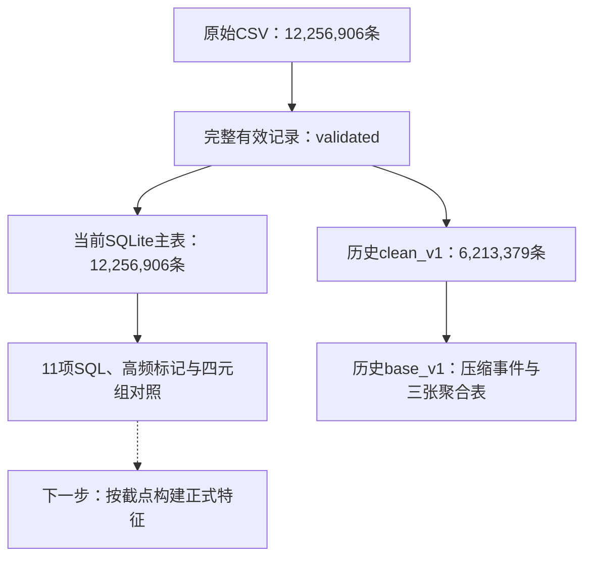

# 已完成任务与文件导航

整理日期：2026-10-25。项目本地根目录：`/Users/alina/Desktop/实习/Github`。

本页按实际文件、数据清单和已保存验收结果整理。全阶段状态见[任务台账](project_roadmap.md)，项目启动方式见[仓库首页](../README.md)。

2026-10-28新增：[第一阶段与第二阶段第1项逐文件清单](stage1_stage2_step1_files.md)，按任务列出421个基线文件的目录、文件名、用途与同步状态；[JSON对应表](../data/catalog/stage1_stage2_step1_files.json)提供同一份结构化记录。

## 1. 先看当前进度

| 内容 | 当前状态 | 首先打开哪份文档 |
|---|---|---|
| 第一阶段第1项：工程环境与版本管理 | 已完成，后续持续回归 | [工程完成记录](stage1_completion.md) |
| 第一阶段第2项：文献与技术栈 | 已完成调研和方案，研究中的实验仍待执行 | [研究阅读导航](research/README.md) |
| 第一阶段第3项：全量加载与清洗 | 已完成全量处理与核验；历史归并版本和完整有效记录均保留 | [清洗报告](../outputs/reports/stage1_step3/README.md)、[当前重复值策略](duplicate_policy.md) |
| 第一阶段第4项：预处理与中间表 | 已完成历史归并版本的压缩、三维聚合与核验 | [预处理报告](../outputs/reports/stage1_step4/README.md) |
| 补充课题：用户小时分布与重复值研究 | 分布分析、附件归档、独立核验和90条标记方案已完成 | [分布报告](../outputs/reports/user_hour_distribution_20261023/README.md)、[附件与核验](../outputs/reports/duplicate_review_20261024/README.md) |
| 第二阶段第1项：SQLite与SQL分析 | 已完成全量数据库、接口、11项SQL及核验 | [数据库与SQL报告](../outputs/reports/stage2_step1_20261024/README.md) |
| 第二阶段第2项：全维度特征体系 | 已有设计和教学示例；正式特征表尚未生成 | [候选特征方案](research/feature_engineering_plan.md) |
| 第二阶段第3、4项 | 特征预处理/有效性验证、完整EDA待执行 | [任务台账](project_roadmap.md) |
| 第三、四阶段 | 建模、模型评估及最终汇报等待执行 | [任务台账](project_roadmap.md) |

第一阶段四项、第二阶段第1项已有实现和验收证据。重复值研究是补充课题，教学示例不计作正式特征工程交付。

## 2. 怎样理解项目文件夹

| 目录 | 里面放什么 | 查找目的 |
|---|---|---|
| `docs/` | 规则、操作说明、调研和方案 | 了解为什么这样做、应当怎样做 |
| `configs/` | 实际运行参数和业务策略 | 查看处理程序采用什么设置 |
| `src/user_behavior_analysis/` | Python实现 | 查看程序怎样完成处理 |
| `scripts/` | 安装、运行、核验入口 | 找到运行某项任务的入口 |
| `sql/` | 建表、索引、诊断和查询SQL | 查看数据库结构和分析口径 |
| `data/raw/` | 原始数据的本地入口 | 找到只读CSV；当前入口为软链接 |
| `data/interim/` | 校验后数据和处理中的大表 | 找到完整有效记录及历史清洗结果 |
| `data/processed/` | 压缩Parquet、聚合表、SQLite和查询输出 | 使用处理后的数据 |
| `data/catalog/` | 数据来源、行数、路径、指纹和生成信息 | 在GitHub上确认本地大数据的身份与位置 |
| `outputs/reports/` | 完成报告、核验结果、小型统计表和图表 | 查看做出了什么、有什么证据 |
| `outputs/learning/` | 本地教学示例 | 学习概念，不作为正式业务计算结果 |
| `tests/` | 单元和集成测试 | 查看程序的已覆盖场景 |
| `.github/workflows/`、`.githooks/` | 云端和本地提交检查 | 查看工程质量门禁 |

## 3. 第一阶段第1项：工程环境与版本管理

### 已完成什么

- 配置Python、Pandas、NumPy、Dask和PyArrow，锁定依赖版本。
- 提供环境安装、运行、资源检查及样本测量入口。
- 建立代码、配置、数据、文档、结果分层目录。
- 建立main/dev/feature分支与提交规范、GitHub同步流程。
- 落实编码规范、函数说明、类型检查、本地hooks和Quality CI。

### 文件对应关系

| 要看什么 | 文件或目录 |
|---|---|
| 工程任务完成情况 | [docs/stage1_completion.md](stage1_completion.md) |
| 环境安装与依赖 | [scripts/setup_environment.sh](../scripts/setup_environment.sh)、[requirements.txt](../requirements.txt)、[requirements-dev.txt](../requirements-dev.txt) |
| 统一运行入口 | [scripts/run_project.sh](../scripts/run_project.sh)、[api/cli.py](../src/user_behavior_analysis/api/cli.py) |
| 日常Dask资源配置 | [configs/dask.yaml](../configs/dask.yaml) |
| 全量审计资源配置 | [configs/audit.yaml](../configs/audit.yaml) |
| 数据和大文件管理 | [docs/data_management.md](data_management.md) |
| GitHub Desktop操作 | [docs/github_sync_guide.md](github_sync_guide.md) |
| 编码与函数注释要求 | [AGENTS.md](../AGENTS.md)、[规范落地说明](coding_standard_adoption.md) |
| 质量检查入口与云端流程 | [scripts/check_quality.sh](../scripts/check_quality.sh)、[quality.yml](../.github/workflows/quality.yml) |
| 环境复现历史证据 | [environment_reproduction.json](../outputs/reports/environment_reproduction.json) |
| 最新完整验收中的真实环境检查 | [environment_check.json](../outputs/reports/stage1_review_20261024_04/environment/environment_check.json) |

日常配置每worker最多1GiB；专用审计配置每worker最多1536MiB，资源规划仍受可用内存预算约束。样本benchmark与全量流水线是不同测量范围。

## 4. 第一阶段第2项：文献调研与技术方案

已完成五篇论文笔记、数字平台案例和技术栈对比，形成26个候选特征与10项实验设计。这里的特征和实验属于研究方案，不能据此认定特征表或模型已完成。

| 内容 | 文件 |
|---|---|
| 阅读入口 | [docs/research/README.md](research/README.md) |
| 五篇论文的方法、结果与局限 | [literature_review.md](research/literature_review.md) |
| Spark/Dask和模型选择 | [tech_stack_comparison.md](research/tech_stack_comparison.md) |
| 候选特征、窗口和缺失字段边界 | [feature_engineering_plan.md](research/feature_engineering_plan.md) |
| 未来7天标签、样本与评估设计 | [experiment_plan.md](research/experiment_plan.md) |
| 参考来源 | [references.json](research/references.json)、[references.bib](research/references.bib) |
| 完成报告与专项复核 | [stage1_step2_research.md](../outputs/reports/stage1_step2_research.md)、[stage1_step2_audit.md](../outputs/reports/stage1_step2_audit.md) |

研究文档保留其形成时的日期与设计；实际数据范围、当前重复值策略和当前实施进度以本页、任务台账及新验收记录为入口。

## 5. 第一阶段第3项：全量加载与清洗

### 已完成什么

- 全量读取12,256,906条记录，检查结构、必填字段、ID、行为编码和小时格式。
- 核验商品类目一致性，完成IQR/3σ活跃次数异常诊断与标记。
- 保留全部有效记录，同时形成历史四元组归并结果。
- 用独立处理流程核对行数、键、统计值、读回内容和文件指纹。

| 类型 | 本地数据位置 | 行数/用途 | GitHub中的清单 |
|---|---|---|---|
| 原始CSV入口 | `data/raw/user_behavior.csv` | 12,256,906条；只读接入 | [user_behavior_raw.json](../data/catalog/user_behavior_raw.json) |
| 完整有效记录 | `data/interim/clean_v1/validated/` | 12,256,906条；当前第二阶段输入 | [validated_records_v1.json](../data/catalog/validated_records_v1.json) |
| 历史归并事件 | `data/interim/clean_v1/events/` | 6,213,379条；保留四元组一条的历史版本 | [clean_v1.json](../data/catalog/clean_v1.json) |
| 异常诊断 | `data/interim/clean_v1/activity_anomalies/` | 活跃次数及异常标记 | [清洗质量报告](../outputs/reports/stage1_step3/quality.json) |

| 要看什么 | 对应文件 |
|---|---|
| 清洗结论与数据规模 | [outputs/reports/stage1_step3/README.md](../outputs/reports/stage1_step3/README.md) |
| 计算规则与运行方式 | [docs/cleaning_rules.md](cleaning_rules.md)、[configs/cleaning.json](../configs/cleaning.json) |
| 来源与业务约定 | [docs/data_provenance.md](data_provenance.md)、[docs/business_conventions.md](business_conventions.md) |
| 清洗与校验实现 | [service/cleaning.py](../src/user_behavior_analysis/service/cleaning.py)、[service/validation.py](../src/user_behavior_analysis/service/validation.py) |
| 独立核验入口与证据 | [scripts/audit_cleaning.py](../scripts/audit_cleaning.py)、[audit.json](../outputs/reports/stage1_step3/audit.json) |

源时间范围为2025-11-18 00时至2025-12-18 23时，31天；共有10,000名用户、2,876,947件商品、8,916个类目。任务名称中的“亿级”是规模目标，已验收的实际数据量为上述全量CSV。

## 6. 第一阶段第4项：类型压缩与基础中间表

本项以历史6,213,379条事件为输入，完成无损类型压缩、Parquet存储及三张聚合表。六列规范值读回一致，全部聚合组和指标独立比较一致。

| 产物 | 本地数据位置 | 规模 |
|---|---|---:|
| 类型压缩事件 | `data/processed/base_v1/events/` | 6,213,379条，32个Parquet |
| 用户日统计 | `data/processed/base_v1/aggregates/user_daily_stats/` | 202,324组 |
| 商品日统计 | `data/processed/base_v1/aggregates/item_daily_stats/` | 4,683,584组 |
| 小时统计 | `data/processed/base_v1/aggregates/time_hourly_stats/` | 744组 |

| 要看什么 | 对应文件 |
|---|---|
| 结果与体积/读写测量 | [outputs/reports/stage1_step4/README.md](../outputs/reports/stage1_step4/README.md) |
| 类型、聚合与运行规则 | [docs/preprocessing_rules.md](preprocessing_rules.md)、[configs/preprocessing.json](../configs/preprocessing.json) |
| 文件列表及指纹 | [data/catalog/base_v1.json](../data/catalog/base_v1.json) |
| 预处理与聚合实现 | [service/preprocessing.py](../src/user_behavior_analysis/service/preprocessing.py)、[dao/preprocessing_repository.py](../src/user_behavior_analysis/dao/preprocessing_repository.py) |
| 独立核验入口与证据 | [scripts/audit_preprocessing.py](../scripts/audit_preprocessing.py)、[audit.json](../outputs/reports/stage1_step4/audit.json) |

事件Parquet从161.61MiB减至77.20MiB；这是同一事件集的存储优化。本项三张表采用历史归并口径，不能直接当作当前完整原记录口径的特征表；全期汇总也不能直接回填到历史预测截点。

## 7. 补充课题：重复值分布、材料和当前策略

### 7.1 原始CSV的用户小时分布

统计同一用户在同一完整日期小时内的全部记录数，覆盖682,940个活跃用户小时。中位数9、P90为45、最大值862；统计包含跨商品、跨行为的全部记录。

- [分析报告与口径](../outputs/reports/user_hour_distribution_20261023/README.md)。
- [Excel分布表](../outputs/reports/user_hour_distribution_20261023/user_hour_distribution.xlsx)。
- [分箱CSV](../outputs/reports/user_hour_distribution_20261023/binned_distribution.csv)、[逐次数CSV](../outputs/reports/user_hour_distribution_20261023/exact_distribution.csv)。
- [分布图](../outputs/reports/user_hour_distribution_20261023/distribution_chart.png)、[机器结果](../outputs/reports/user_hour_distribution_20261023/analysis.json)。
- 全量明细位于本地`data/interim/user_hour_distribution_20261023/user_hour_counts.csv.gz`。

### 7.2 用户材料归档与独立核验

- [归档说明与文件作用](../outputs/reports/duplicate_review_20261024/README.md)。
- [用户原始分析说明](../outputs/reports/duplicate_review_20261024/analysis_notes.md)、[Excel](../outputs/reports/duplicate_review_20261024/user_hour_distribution.xlsx)。
- [四元组出现次数分布](../outputs/reports/duplicate_review_20261024/key_occurrences.csv)、[四类行为影响](../outputs/reports/duplicate_review_20261024/behavior_dedup_impact.csv)。
- [15,428条高频待核查清单](../outputs/reports/duplicate_review_20261024/high_frequency_user_hours.csv)。
- [独立核验结果](../outputs/reports/duplicate_review_20261024/verification.json)、[来源映射与指纹](../data/catalog/duplicate_review_20261024.json)。
- [第二周周报原件](../outputs/reports/weekly_report_20261019_20261023.pdf)、[归档衔接说明](../outputs/reports/weekly_report_20261019_20261023.md)。
- 用户提供的全量明细压缩包位于本地`data/interim/duplicate_review_20261024/user_hour_detail.csv.zip`。

独立核验从原始CSV重建参考结果，682,940个用户小时的全部10项指标与附件一致。

### 7.3 当前执行策略

| 问题 | 当前约定 |
|---|---|
| 第二阶段以哪些记录为主 | 全部12,256,906条有效原记录 |
| 超过90条/用户小时怎么办 | 标记待核查；记录与次数全部保留 |
| 四元组统计怎么使用 | 保存分组及出现次数，用于对照 |
| 是否已证明同小时相同行为都是错误日志 | 尚无此证据；最终错误日志删除规则待研究 |
| 旧归并结果是否仍有用途 | 保留历史验收、存储测量及口径比较 |

超过90条的15,428个用户小时涉及1,956,008条记录和3,357名用户。90是参考线，P90是45，两者含义不同。

正式说明见[docs/duplicate_policy.md](duplicate_policy.md)，实际配置见[configs/duplicate_policy.json](../configs/duplicate_policy.json)。

## 8. 第二阶段第1项：SQLite与SQL分析

### 8.1 数据库与Python接口

数据库本地位置：`data/processed/analysis_raw_v1/behavior.sqlite`，约3.78GiB。

- 主表`behaviors`保留全部12,256,906条记录，以源记录序号为主键。
- 用户、商品、类目、时间、行为类型等关系按明确表结构保存。
- `user_hour_stats`、`high_frequency_user_hours`与`key_occurrences`提供小时统计、高频标记和四元组对照。
- 已完成批量导入、索引、只读参数化Python接口和全量校验。

| 要看什么 | 对应文件 |
|---|---|
| 表关系、运行与业务口径 | [docs/sqlite_analysis.md](sqlite_analysis.md) |
| 建表、索引、诊断 | [schema.sql](../sql/schema.sql)、[indexes.sql](../sql/indexes.sql)、[diagnostics.sql](../sql/diagnostics.sql) |
| 导入实现与读写处理 | [service/database.py](../src/user_behavior_analysis/service/database.py)、[dao/database_repository.py](../src/user_behavior_analysis/dao/database_repository.py) |
| 查询接口 | [dao/sqlite_client.py](../src/user_behavior_analysis/dao/sqlite_client.py) |
| 全部SQL执行与导出入口 | [scripts/run_sql_analysis.py](../scripts/run_sql_analysis.py)、[service/sql_analysis.py](../src/user_behavior_analysis/service/sql_analysis.py) |
| 数据清单 | [data/catalog/analysis_raw_v1.json](../data/catalog/analysis_raw_v1.json) |
| 完成报告 | [outputs/reports/stage2_step1_20261024/README.md](../outputs/reports/stage2_step1_20261024/README.md) |
| 全量导入、逐值审计、SQL执行证据 | [database.json](../outputs/reports/stage2_step1_20261024/database.json)、[database_audit.json](../outputs/reports/stage2_step1_20261024/database_audit.json)、[sql_analysis.json](../outputs/reports/stage2_step1_20261024/sql_analysis.json) |

### 8.2 已执行的11项SQL

| 查询脚本 | 已完成内容 | 完整结果行数 |
|---|---|---:|
| [overview.sql](../sql/queries/overview.sql) | 全量数据概览 | 1 |
| [behavior_distribution.sql](../sql/queries/behavior_distribution.sql) | 四类行为数量与占比 | 4 |
| [daily_active.sql](../sql/queries/daily_active.sql) | 每日活跃用户 | 31 |
| [weekly_active.sql](../sql/queries/weekly_active.sql) | 连续7个自然日的活跃用户 | 31 |
| [popular_items.sql](../sql/queries/popular_items.sql) | 热门商品Top50 | 50 |
| [popular_categories.sql](../sql/queries/popular_categories.sql) | 热门类目Top50 | 50 |
| [user_sequences.sql](../sql/queries/user_sequences.sql) | 用户有记录小时序列和相邻间隔 | 682,940 |
| [funnel_reach.sql](../sql/queries/funnel_reach.sql) | 各类行为覆盖人数 | 4 |
| [strict_funnel.sql](../sql/queries/strict_funnel.sql) | 指定严格跨小时漏斗 | 1 |
| [user_proxy_segments.sql](../sql/queries/user_proxy_segments.sql) | 购买与高频标记的交叉人群 | 4 |
| [item_repurchase.sql](../sql/queries/item_repurchase.sql) | 跨日期购买记录的复购代理 | 92,753 |

完整结果位于本地`data/processed/analysis_raw_v1/sql_results/`；9份小型完整CSV同步在[报告summaries目录](../outputs/reports/stage2_step1_20261024/summaries/)。大型序列和复购明细仅本地保存。

SQL中的小时序列、交叉人群和指定漏斗已经执行；完整序列特征体系、RF/购买次数代理分群及完整EDA仍是后续任务。没有金额、订单号或曝光，现有结果不能解释为真实GMV、订单数或CTR。

## 9. 最新验收和GitHub交付证据

| 想确认什么 | 应打开哪里 |
|---|---|
| 第一阶段四部分的最新验收结论 | [docs/stage1_review.md](stage1_review.md) |
| 数据库接入后的完整回归 | [stage1_review_20261024_04/README.md](../outputs/reports/stage1_review_20261024_04/README.md)、[audit.json](../outputs/reports/stage1_review_20261024_04/audit.json) |
| 最新79项测试及规范、类型检查 | [quality.json](../outputs/reports/stage1_review_20261024_04/quality.json)、[quality.log](../outputs/reports/stage1_review_20261024_04/quality.log) |
| 完整事件、聚合和前序检查 | [preprocessing_audit.json](../outputs/reports/stage1_review_20261024_04/preprocessing_audit.json)、[predecessor_cleaning_audit.json](../outputs/reports/stage1_review_20261024_04/predecessor_cleaning_audit.json) |
| 实现提交的远程三分支与CI | [cloud_delivery.json](../outputs/reports/stage2_step1_20261024/cloud_delivery.json) |
| GitHub项目 | [AlinaSweet/microsoft_user_behavior_analysis](https://github.com/AlinaSweet/microsoft_user_behavior_analysis) |

已保存的最新完整运行日期为2026-10-24，包含63项第一阶段/审计回归和16项数据库用例。10月25日核验实现与交付回执，三分支均通过Quality。实现及回执基线为`2cdb174`；本次补充的是任务导航文档。

`stage1_review_20261024_04`是最新通过入口；同日期`_03`是此前成功记录，`_01`和`_02`保留未通过尝试。旧报告中的11、32、49、59或62项测试对应其生成时点，应结合日期阅读。

## 10. 数据怎样流转

新特征按当前完整记录策略另行构建，并保存截点与历史窗口。已有全期聚合表用于描述和比较，不能默认替代预测时可用的历史特征。

## 11. 哪些在GitHub，哪些仅在本机

| 内容 | 存放与同步状态 |
|---|---|
| 已提交代码、SQL、配置、说明、报告、小型表格和图表 | 纳入Git；现有实现基线已同步GitHub |
| 原始CSV、大型Parquet、SQLite、大型完整查询输出 | 本地数据目录；GitHub保存对应catalog，不能从GitHub直接下载这些大文件 |
| 用户小时全量明细和压缩包 | 本地`data/interim/`；GitHub保存汇总与来源校验信息 |
| 特征工程教学示例 | 本地`outputs/learning/feature-engineering-windows.html`；当前为未提交的教学文件，正式特征尚未生成 |
| 第一周周报草稿 | 本地`outputs/reports/weekly_report_20261012_20261016.docx`、同名`.md`及`_notes.md`；当前尚未提交 |

梳理开始时，`data/catalog/user_behavior_raw.json`、`outputs/reports/engineering_benchmark.json`、`outputs/reports/engineering_benchmark.md`和`outputs/reports/environment_check.json`还有本地未提交修改。最新验收应使用第9节列出的固定记录；本次导航不把这些工作区修改登记为新验收。

## 12. 建议阅读顺序

1. 先读本页第1、2、7节，掌握进度、文件夹作用和当前记录口径。
2. 再按第3—6节查看第一阶段四项的说明与成果。
3. 按第8节查看数据库和已执行SQL，结合报告看结果。
4. 用第9节查验收证据，第11节区分GitHub内容和本地数据。
5. 接下来学习并逐列确定特征，进入第二阶段第2项；实现后再做有效性验证与完整EDA。
