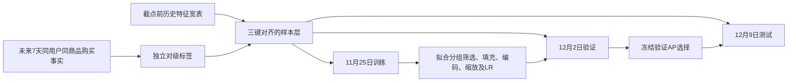

# 对级标签与特征有效性验证

本轮完成日期为2026-11-14。实际结果见
[分组筛选与消融报告](../outputs/reports/feature_validation_20261114/README.md)。

## 数据流与预测问题



主键为`as_of_time,user_id,item_id`。特征使用截点前的历史；购买标签使用
`[as_of_time,as_of_time+7天)`，对应行为类型4。
同一个用户购买其他商品不会使当前商品标签变1。
完整窗口无同商品购买记录为0；无完整未来窗口为NULL。
12月19日全部标签不可用，不能填0或参与训练/验证/测试。

标签保留`label_start、label_end_exclusive、target_available`及两种购买计数。
计数是原日志记录数和不同小时购买键数，均不是订单数或购买件数。
源记录全部保留，超过90条只标记。重复记录不会改变“至少一次”的二分类定义。

## 对齐与候选覆盖验收

从`base_raw_v2/key_hour`生成稠密标签，再从未聚合`events`独立重算每个候选的标签与购买计数。
检查键唯一、非空、截点一致、双向键集合，以及宽表连接前后行数和全部源字段值。
样本只增加标签与窗口管理列，439个特征的源值保持不变。

候选是过去7天有交互的用户商品组合。另报告其对未来全部购买组合的覆盖率，
分母包含新用户和新商品。当前覆盖约11.9%—16.4%，模型评估只适用于已召回候选。

## 时间切分和防泄漏

训练截点2025-11-25、验证截点12-02、测试截点12-09；三个7天标签区间首尾相接、不重叠。
按时间切分，不随机混合截点。数据属于历史回测：已有EDA曾查看这些日期，不能声称全新盲测。
原任务的约7:2:1分层对照和三种不平衡方案仍留在第三阶段。

全量训练集计算缺失率、精确均值/方差、类别词表；数值基数使用近似计数，
常量判定仍使用精确方差，类别基数精确。训练中位数采用全训练数据上的近似分位数。
填充后均值/方差根据训练观测比例与中位数推导；模型使用训练缩放与缺失标记。
类别用训练词表独热编码，未见类别或缺失进入独立未知桶，不把ID数字当连续量。
用户ID、商品ID、类目主键、截点、源时间和答案不作为模型输入。

验证、测试仅调用冻结变换。固定候选分群规则、相关性阈值、字段上限和SGD参数
在运行前写入配置；没有利用测试结果改规则或重新选择模型。
SVD、IDF、词表和共现图继续冻结在11月25日前；未来截点历史投影不重新拟合其模型。

## 分组、两轮筛选与人群诊断

439标量分为基础289、业务78、序列统计22、SVD40、共现5、日历5。
6类原始序列数组单独保存。SVD40已经包含32个坐标，不再重复计数。

第一轮移除训练全缺失/常量，普通字段缺失率达到95%暂缓；RF/漏斗和高级组有显式例外。
30天窗口在三个成熟截点都不完整，暂缓用于本轮模型；单训练截点日历不可学习。
受保护RF代理继续保留，但仅代表实际已观测的7/14/21天历史，不能解释为完整30天价值。
这只是本轮输入决定，不修改原字典或删除源字段。

第二轮按组估计互信息，按训练样本Spearman绝对值≥0.98标记冗余，再应用组内字段上限。
互信息使用按用户商品键哈希排序的均匀100000行训练样本，并正确区分离散和连续字段。
40个非恒定RF/漏斗字段有业务保护；不单凭低互信息删除。
跨组高相关关系单独列出，保留用于预先声明的组增量实验，未声称所有剩余列相互独立。

低活跃使用已有固定活动级别0，高活跃为级别≥2；新近观测指首次已见历史距截点≤3天，
不是新注册。分组可以重叠。
每个人群从完整训练人群内部均匀取最多15000行，保存总体与样本正负支持量；
SVD/共现进一步限定在其可覆盖人群。任一类别不足10行时，该项MI标记不可估计。
验证/测试分别记录同类人群的实际效果与覆盖变化，不据此重拟合筛选。

## 逻辑回归消融与冻结选择

使用`SGDClassifier(loss="log_loss", average=True)`分批优化线性逻辑回归，
L2系数0.0001、固定5轮、批次8192、随机种子20261114。
各模型使用相同完整训练行与顺序；不负采样、不过采样、不SMOTE。
组内独热编码和缺失指示会增加矩阵列数，不能计作新增原始业务特征。

预先固定六组：基础、基础+业务、基础业务+序列、基础业务+SVD、基础业务+共现、组合。
SVD不可用回退基础业务模型；共现不可用同样回退；组合两者均未知时回退序列模型。
回退只读取历史可用标记，不看标签。

输出全量AUC、AP、混淆矩阵、精确率、召回率、F1和准确率。
分类阈值预先固定0.5，召回较低，未声称是生产最优阈值；概率未校准。
验证AP最高的序列组在测试预测开始前写入冻结记录；测试同时展示预先列明的六组，
不通过测试结果调参或重选赢家。
用户聚类配对bootstrap100次给出各组相对基础业务的AUC差值区间；
它描述当前时间窗口的不确定性，不能替代多个独立时间回测。

保存本地模型和全量预测，再直接从系数、截距与冻结变换计算概率，
逐行核验用户商品顺序、答案和全部六组概率。

## 文件与复现

- 配置：`configs/feature_validation.json`。
- 标签：`data/processed/pair_targets_v1/{截点}/pair_targets.parquet`。
- 成熟样本：`data/processed/model_samples_v1/{截点}/part_*.parquet`。
- 模型与预测：`data/processed/model_samples_v1/models.joblib`、`predictions/`。
- 小型报告：`outputs/reports/feature_validation_20261114/`。
- 最终目录：`data/catalog/feature_validation_v1.json`。

从仓库根目录执行：

```bash
MPLCONFIGDIR=.cache/matplotlib PYTHONPATH=src \
  OPENBLAS_NUM_THREADS=1 OMP_NUM_THREADS=1 \
  .venv/bin/python -B -u scripts/run_feature_validation.py --phase all
```

依次执行samples、selection、experiments、audit、report。
前3阶段拒绝覆盖现有版本。重建请先在新配置中改用新的label_root、sample_root、report_dir和catalog，
保留旧目录。源CSV、原宽表和旧报告无需重建。

大型文件仅保留本地；Git同步代码、配置、方法、清单和小型指标。
本次只完成对级监督预实验；XGBoost/LightGBM、深度模型、完整调参、三种不平衡对照
和多时间折稳定性仍按第三阶段推进。
