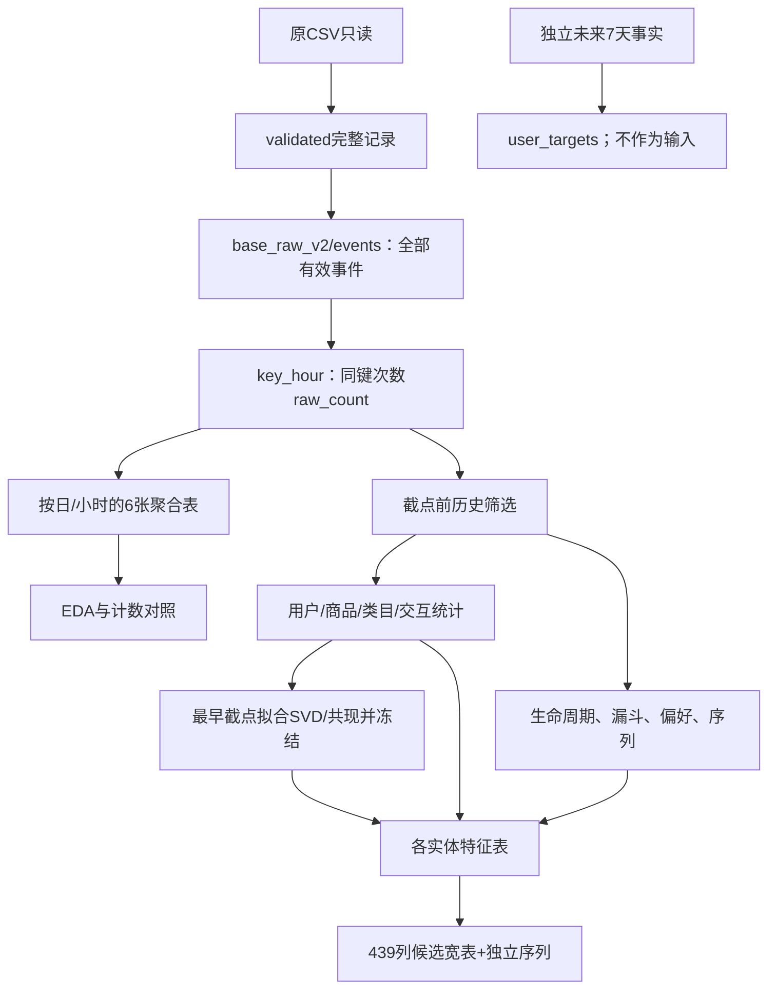

# 当前中间表与特征表设计

依据：全量保留记录政策、看板一EDA及新增分层比较。原始五列仍只读接入。
原始记录与四元组计数同时保留，>90条/用户小时只标记。

## 时间边界与表粒度

预计算日表包含全观测期。正式特征先按截点筛选历史，不能将全期合计回填给历史样本。
EDA缓存用于探索，不直接替代按截点构建的模型输入。

## 新版本中间表

根目录：data/processed/base_raw_v2/。以下表已按完整有效记录重建。

| 表 | 一行代表 | 键 | 主要用途 |
|---|---|---|---|
| events | 一个有效源记录 | event_id | 保留12,256,906条记录和源序号 |
| key_hour | 用户在同小时对同商品的一种行为 | user_id,item_id,behavior_type,event_time | 记录出现次数，不删除原始事实 |
| user_daily_stats | 某用户某日 | user_id,event_date | 活跃、次数、覆盖、生命周期 |
| item_daily_stats | 某商品某日 | item_id,category_id,event_date | 热度、购买覆盖、衰减 |
| time_hourly_stats | 某完整日期小时 | event_time,event_date | 时序与日历探索 |
| user_item_daily_stats | 某用户某商品某日 | user_id,item_id,category_id,event_date | 重复关注、持续意向、候选对 |
| user_category_daily_stats | 某用户某类目某日 | user_id,category_id,event_date | 类目偏好与集中度 |
| user_hour_stats | 某用户某小时 | user_id,event_time | 高频标记、时间桶序列及独立核对 |

每日表同时记录原始数量、四元组数量及四行为数量；不同粒度间不能直接相加不同用户数。
表的实际行数、字段、文件、指纹与计数控制写入data/catalog/base_raw_v2.json。

## 正式特征快照

根目录：data/processed/features_raw_v2/。

- 截点：2025-11-25、2025-12-02、2025-12-09、2025-12-19的00:00。
- 历史窗口：[t-W天,t)，W=1/3/7/30。30天不足时保留实际观测覆盖，不伪造补齐。
- 用户、商品、类目、用户类目、用户商品对表按实体ID与as_of_time连接。
- 候选用户商品对只取历史7天已交互过的组合，不从未来购买反推候选。
- 标签文件与特征分开。12月19日没有完整未来窗口，不生成可用购买标签。
- 序列按小时桶处理并列，保留原始次数；技术排序不代表小时内真实顺序。
- SVD与共现词表仅在11月25日前的训练历史拟合，后续截点使用冻结映射。

## 旧版本衔接

clean_v1/events、base_v1及其中三张聚合表保留为历史对照；
当前正式特征依赖新的base_raw_v2，不再从旧归并事件或其聚合表取值。
clean_v1/validated是此前保存的完整有效记录；本轮从其受指纹保护的全部记录重新生成新版本。
历史测量报告保留成文时的口径；当前版本以数据清单和完成报告为准。

## 实际行数与读取入口

| 表 | 行数 | 文件 |
|---|---:|---|
| events | 12,256,906 | data/processed/base_raw_v2/events/part_*.parquet |
| key_hour | 6,213,379 | data/processed/base_raw_v2/key_hour/data.parquet |
| user_daily_stats | 202,324 | data/processed/base_raw_v2/aggregates/user_daily_stats/data.parquet |
| item_daily_stats | 4,683,584 | data/processed/base_raw_v2/aggregates/item_daily_stats/data.parquet |
| time_hourly_stats | 744 | data/processed/base_raw_v2/aggregates/time_hourly_stats/data.parquet |
| user_item_daily_stats | 5,288,603 | data/processed/base_raw_v2/aggregates/user_item_daily_stats/data.parquet |
| user_category_daily_stats | 1,862,252 | data/processed/base_raw_v2/aggregates/user_category_daily_stats/data.parquet |
| user_hour_stats | 682,940 | data/processed/base_raw_v2/aggregates/user_hour_stats/data.parquet |

## 依赖图

每日全期表是预计算层；当前实现的正式快照从新key_hour先按时间筛选，再汇总为特征，
因此不会因为已有全期日表而把未来合计连接到过去。
features.duckdb是本地可重建计算缓存；以completion.json登记的Parquet/NPZ为交付数据。
