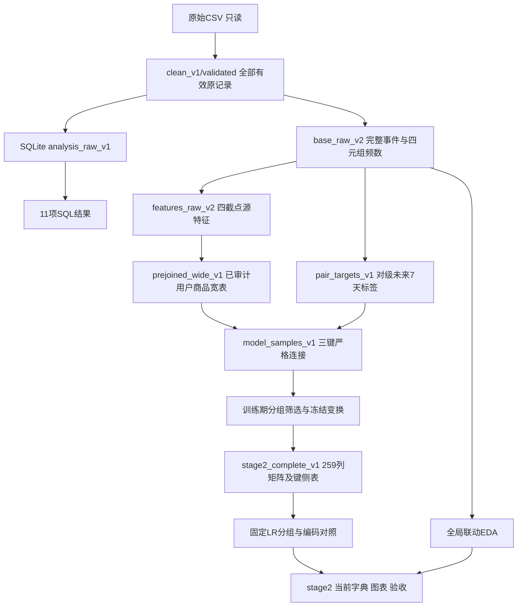

# 仓库地图与文件依赖

按[仓库首页](../README.md)中的四阶段顺序阅读，逐文件说明见[按阶段逐文件导航](files_by_stage.md)。
本页说明物理结构与数据依赖；[全部Git文件清单](file_inventory.csv)按阶段列出文件、用途、类型及直接导入或参考依赖。大型数据另由catalog登记，不属于Git文件清单。

## 按阶段找文件

| 阶段/部分 | 方法文档 | 实现/配置 | 产物与验收 |
|---|---|---|---|
| 第一阶段1 工程环境与Git | stage1_completion.md、AGENTS.md | config.py、service/runtime.py；configs/dask.yaml；.githooks、.github | outputs/reports/stage1；engineering_benchmark* |
| 第一阶段2 研究与方案 | docs/research/全目录 | references.json/bib、experiment_plan.md | stage1_step2_research.md、stage1_step2_audit* |
| 第一阶段3 清洗与质量 | cleaning_rules.md、duplicate_policy.md | service/cleaning*；audit_cleaning.py | clean_v1清单、stage1_step3；当前有效原记录validated_records_v1 |
| 第一阶段4 压缩与中间表 | preprocessing_rules.md | service/preprocessing*；audit_preprocessing.py | base_v1、stage1_step4；当前保留记录基表base_raw_v2 |
| 第二阶段1 SQLite与SQL | sqlite_analysis.md | service/database*、sql_analysis.py、dao/sqlite_client.py、sql/ | analysis_raw_v1清单、stage2_step1_20261024 |
| 第二阶段2 特征与预拼接 | feature_system.md、intermediate_table_design.md、prejoined_features.md | configs/feature_system.json；service/feature_*、latent_*、wide_*；dao/wide_repository.py | features_raw_v2/prejoined_wide_v1清单；源生成及预拼接报告 |
| 第二阶段3 筛选与变换 | feature_validation.md、stage2_preprocessing.md | validation_*、target_encoding.py、sparse_embedding.py、completion_*；两份validation/delivery配置 | feature_validation_v1、stage2_complete_v1清单；stage2/audit.json、字典、矩阵及对照 |
| 第二阶段4 EDA | eda_dashboard1.md | interactive_eda/paths/forward.py、dashboard_server.py、assets/eda；run_eda_dashboard.sh | stage2/eda_*.json、figures、tables及交互看板 |
| 第三阶段1 样本构建与划分 | stage3_sampling.md | configs/stage3_sampling.json、scripts/run_stage3_sampling.py | stage3_samples_v1 清单、六个自然分布 Parquet、分层与不平衡对照报告 |
| 第三阶段2 传统模型与调优 | stage3_traditional.md | configs/stage3_traditional.json、scripts/run_traditional_models.py | 基线及调优模型、试验记录、时间测试报告和预测清单 |

表中方法文件位于docs/，实现位于src/user_behavior_analysis/；文件清单给出无缩写完整相对路径。

## 根目录各类文件

| 路径 | 用途 |
|---|---|
| README.md | 按项目大纲四阶段展开成果、状态和启动步骤 |
| docs/files_by_stage.md / file_inventory.csv | 全部Git文件的阶段归属、作用及依赖入口 |
| AGENTS.md | 本项目必须遵守的代码、管理和验收要求 |
| .git/ | 本机提交、分支、远程信息，Git自己维护，不作为项目文件再次上传 |
| .github/workflows/quality.yml | 每次推送执行远程质量检查 |
| .githooks/ | 提交/推送前本地检查，与远程CI互补 |
| .gitignore / .gitattributes | 控制同步范围、换行和大/二进制文件展示 |
| .editorconfig / .flake8 / pyproject.toml | 编辑器、格式、类型和静态检查规则 |
| .python-version / requirements*.in / requirements*.txt | Python版本、直接依赖和精确锁定版本 |
| configs/ | 项目参数与版本输出路径，改变业务规则必须新版本 |
| scripts/ | 安装、运行、独立审计与Excel生成入口 |
| src/user_behavior_analysis/ | 可执行Python包与本地看板静态资源 |
| tests/unit / tests/integration | 逻辑边界与真实worker/HTTP流程测试 |
| sql/schema.sql、indexes.sql、queries/ | 数据库结构、索引和11项分析 |
| data/catalog/ | 版本、粒度、输入/输出指纹和数据边界，是数据依赖入口 |
| data/summaries/ | 小型可同步统计；eda_support_v1保存验收过的补充EDA稳定输入 |
| data/raw、interim、processed/ | 原始源、历史清洗与大型正式产物，本地保存 |
| docs/ | 方法、口径、原始要求、研究与当前导航 |
| outputs/reports/ | 当前汇总及仍被引用的基线证据，目录说明见其README |
| .venv、.cache、__pycache__/ | 本机依赖、暂存与字节码，不上传Git |

## 数据依赖链

历史clean_v1/events及base_v1为归并口径对照，当前特征不读取它们。
用户级user_targets仅供独立补充分析，不能拼作用户商品标签。
完整矩阵/键/预测文件的指纹集中在stage2/preprocessing.json及encoding_experiments.json。

## 跨模块责任与接口

| 模块 | 责任 |
|---|---|
| dao/completion_repository.py | 读取新配置与已验收输入；限制输出路径 |
| models/encoding_models.py、dashboard_models.py | 定义编码状态、变换参数和不可变筛选条件 |
| service/target_encoding.py | 用户分组OOF映射、未知回退和成熟时间保护 |
| service/sparse_embedding.py | 冻结类别稀疏投影与统一矩阵变换 |
| service/completion_pipeline.py | 全训练拟合与四截点逐片落地 |
| service/completion_experiments.py | 固定六组新增LR、覆盖回退、两组旧参考与分群评价 |
| service/completion_audit.py | 全矩阵、目标映射与保存概率重放 |
| dao/dashboard_repository.py | SQL结果类型与序列化适配 |
| service/interactive_eda.py | 全局人群、日期、类目与核心聚合 |
| service/interactive_paths.py | 成熟严格漏斗与小时多标签转移 |
| service/interactive_forward.py | 对级/用户级成熟未来购买分开统计 |
| api/dashboard_server.py | 仅本机HTTP、白名单资源、参数校验和CSV导出 |
| assets/eda/*.html/css/js | 控件、布局、图形和交互，不另算业务数据 |
| service/stage2_dictionary.py、stage2_figures.py、stage2_reporting.py | 当前字典、分组图与统一结果报告 |

旧版EDA生成器仍可复现基线；默认阅读入口已统一，旧报告从[归档](archive_manifest.json)或历史提交恢复。
