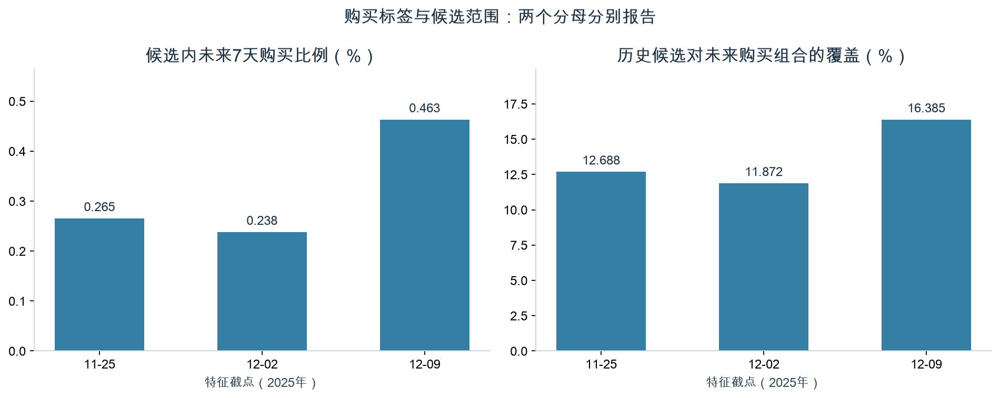
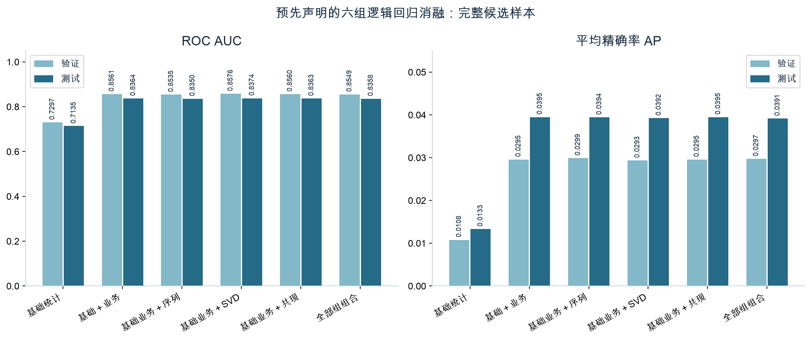

# 对级标签、分组筛选与逻辑回归消融验收

日期：2026-11-14。

本次完成导师要求的对级标签、三键对齐、训练期分组筛选、编码缩放和分组消融。
原始记录、旧宽表及历史报告保留；新产物使用独立版本。

## 1. 任务、粒度和标签

预测对象是过去7天交互过的用户商品组合。唯一键为as_of_time、user_id、item_id。
标签1表示同一用户对同一商品在[t,t+7天)至少出现一条购买记录；
完整窗口无购买记录为0，未来不可观测为NULL。标签不是订单数、购买件数或用户级标签。

| 截点 | 用途 | 候选行数 | 正例 | 负例 | 未知 | 候选购买覆盖 |
|---|---|---:|---:|---:|---:|---:|
| 2025-11-25 | train | 1,030,893 | 2,735 | 1,028,158 | 0 | 12.69% |
| 2025-12-02 | validation | 1,061,515 | 2,525 | 1,058,990 | 0 | 11.87% |
| 2025-12-09 | test | 1,117,324 | 5,175 | 1,112,149 | 0 | 16.39% |
| 2025-12-19 | 无标签快照 | 1,216,917 | 0 | 0 | 1,216,917 | 不可评估 |

候选覆盖的分母是未来窗口全部购买组合，包括新用户、新商品。
因此候选内AUC/AP不能当作覆盖全商城的推荐效果。
三成熟截点共3,209,732行。由完整原始事件独立重算标签与两种购买计数，差异0；
主键、键集合与样本源值检查通过。12月19日全部1,216,917个结果未知。

## 2. 分组筛选与训练边界

| 组别 | 原始候选字段 | 本次保留 |
|---|---:|---:|
| basic | 289 | 80 |
| business | 78 | 64 |
| sequence | 22 | 22 |
| svd | 40 | 36 |
| cooccurrence | 5 | 5 |
| calendar | 5 | 0 |

439个标量中保留207个进入本轮预实验；这不是新增207个特征。
6类原始序列数组仍独立保存，LR使用已有22个序列统计字段。
所有缺失填充、完整训练矩、类别词表、组内相关性、互信息和筛选均只拟合11月25日训练样本。
验证与测试只使用冻结变换。SVD/IDF/共现仍使用11月25日前冻结版本。
常量不强行输入模型；明示30天窗口的统计字段暂缓；日历在单训练截点内不可学习。
受保护RF代理仍代表7/14/21天实际已观测历史，不能解释为完整30天价值。
40个非恒定RF/漏斗字段按业务保护保留。高相关字段记录明确原因，跨组冗余另有诊断。
原始业务缺失保留在源表；模型层使用训练中位数、缺失标记和训练缩放，类别未知进入独立桶。

互信息总览使用训练候选均匀确定性抽样100,000行，包含261个正例。
低活跃、高活跃与新近观测人群另从完整训练人群内取样，保存总体/样本支持量。
SVD/共现还在各自可覆盖样本中单独估计。少于10个正例或负例时不报告该项互信息。
训练画像、模型拟合、验证和测试均使用全量；MI估计没有冒称全量。

## 3. 六组消融结果

| 输入 | 验证AUC | 测试AUC | 验证AP | 测试AP |
|---|---:|---:|---:|---:|
| 基础统计 | 0.7297 | 0.7135 | 0.01078 | 0.01329 |
| 基础＋业务 | 0.8561 | 0.8364 | 0.02955 | 0.03946 |
| 基础业务＋序列 | 0.8535 | 0.8350 | 0.02988 | 0.03940 |
| 基础业务＋SVD | 0.8576 | 0.8374 | 0.02933 | 0.03921 |
| 基础业务＋共现 | 0.8560 | 0.8363 | 0.02954 | 0.03946 |
| 全部组组合 | 0.8549 | 0.8358 | 0.02970 | 0.03915 |

AUC衡量正例排在负例前面的能力；AP汇总不同召回水平的精确率，正例稀少时尤其需要一起看。
AP受正例比例影响，不能把测试AP高于验证AP直接解释为模型改善；组间比较均在同一窗口。
基础业务组明显优于基础统计。SVD仅有小幅AUC增益，AP没有同步提升。
序列和共现未显示一致增益，全部组组合也没有全面超过基础业务组。

验证AP最高为“基础业务＋序列”，该选择在测试预测前写入冻结记录。
全部实验事先列明，测试结果没有用于改筛选、改模型或重选赢家。
SVD未知回退基础业务，图未知同样回退；组合模型两者均未知时回退序列组。
全体、低/高活跃、新近观测、SVD可用/未知、共现可用/未知分别保存精确指标。
用户聚类配对bootstrap100次给出AUC差值区间，避免把同一用户的多行当成完全独立样本。

## 4. 资源、复核与限制

每组每轮完整访问1,030,893行，共5轮。
六组联合分批拟合耗时38.97秒，批次间观测最大RSS约622.3MiB。
该RSS是采样观察值，不声称捕获每一个瞬时峰值；拟合时间不含筛选、预测、bootstrap和复核。
使用SGD优化的线性逻辑回归，未负采样、未SMOTE、未利用验证/测试拟合变换。
固定0.5阈值下召回较低；概率未做校准，当前结果不能作为生产决策阈值。
直接由持久化系数重新计算全部验证/测试概率，检查见prediction_replay.json。
完整质量门禁、前序阶段回归和输入/输出指纹另存验收文件。

已有EDA看过这三个日期，属于历史时间回测，不是全新盲测。
仅一个训练/验证/测试截点组合；31天短历史与早期窗口不足限制稳定性结论。
没有金额、订单和曝光，RF是代理，不提供真实金额型RFM、GMV、CTR或订单复购。

## 5. 文件与复现

- samples.json：全量标签、候选覆盖、三键/源值核验、所有源指纹及样本清单。
- selection.json、feature_decisions.csv：439列决定、训练统计与冻结编码缩放。
- training_group_diagnostics.json：完整训练人群支持量、条件MI、跨组冗余。
- experiments.json、metrics.csv：全量模型/人群指标、bootstrap与资源观察。
- frozen_validation_choice.json：在读取测试结果之前登记的模型选择。
- prediction_replay.json：全部概率由系数直接重放的审计。
- quality.json、code_review.md、source_manifest.json：规范、评审和版本证据。
- 大型标签、样本、模型和预测位于data/processed，不上传Git。

方法与命令见[特征验证方法](../../../docs/feature_validation.md)。
